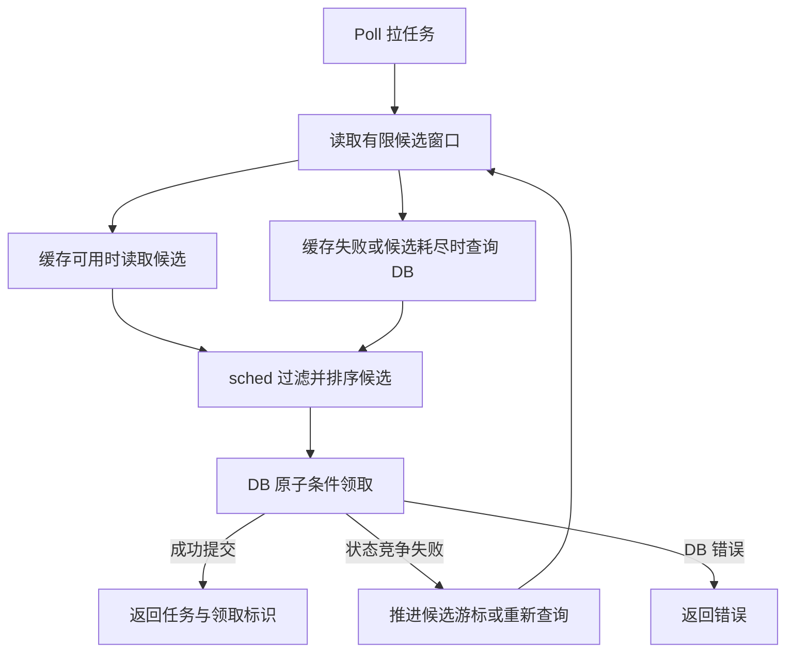

# 从 sched 拉任务需求评估 cacheloader

本文保留 sched 源码评估及未实施的领取/恢复建议。库侧已改为独立的只读快照设计，
当前能力以 string.md / zset.md 为准；下文“原型”指此前暴露 ZPop 的草稿。

## 结论与范围

Redis 故障时继续获取任务的需求成立，但不能靠“ZPop 失败后加载 DB”完成。
可行方向是：**可回源的候选读取 + DB 条件领取 + 可恢复的执行状态**。
cacheloader 负责第一部分的通用读取策略；领取、重试、心跳和调度偏好留在 sched。

库侧已移除业务侧 ZAdd/ZPop；zset 按独立完整快照读取设计落地，不以 sched 消费队列为适用依据。
若以后有独立的排序范围/排名读取需求，可保留只读集合能力，但不应以 sched 消费队列为理由引入它。
小型有序候选快照可以用普通值缓存承载，没有必要为了底层采用 zset 就暴露 zset 操作。

本文未实施 sip 修改；本仓库的旧 zset 增删草稿已由只读快照接口取代。
下述 Claim、候选分页、熔断/并发策略属于建议，不能当成已交付能力。

## 源码证据

核对的是本地 `sip` 工作区（包含已有未提交修改），不是线上部署状态。
参考仓库：`/Users/luoyuhao/go/src/gitlab.prod.shu.team/eng-be/sip`，以下路径相对此仓库。

| 入口 | 已观察到的行为 |
| --- | --- |
| `sched/internal/service/task.go:Poll` | 逐队列 Dequeue；非 NotFound 错误可终止本次拉取；领取后另外批量更新 Worker |
| `sched/internal/biz/queue_cacher.go:Pop` | 默认 ZPOPMIN；启用 TASK_AFFINITY_ENABLED 时运行 dispatcher Lua；Redis 出错直接返回 |
| `sched/internal/biz/queue.go:Dequeue` | 最多尝试 5 次；取候选后按 state=queueing 更新 DB 为 dequeued，冲突则继续 |
| `sched/internal/biz/task.go:UpdateAndGetFull` | 事务内强制 Returning、ErrOnNotFound，并加载 annex；查询失败回滚 |
| `sched/internal/biz/queue_cacher.go:SyncQueueCache` | DB 查询 queueing、有效时间范围，priority DESC / id 排序；默认取 500 条后 ZADD，非完整集合快照 |
| `sched/internal/biz/queue.go:Enqueue` | 先创建 DB 任务，Redis Add 失败被忽略 |
| `sched/internal/biz/queue_dispatcher.go:dispatchScript` | 同时做集群约束、ETC 估计、worker 分配和 ZREM；不等价于最小分值弹出 |
| `sched/internal/data/queue_cache.go:GetTryTime/PostDequeue` | 重试次数存 Redis；出队后 pipeline 写预计完成时间、心跳、次数 |
| `sched/internal/biz/qmgr_sweep.go:SweepHeartbeatTimeoutTasks` | 从 Redis 心跳识别超时，再更新 DB 状态并安排重试 |
| `sched/internal/service/task_v2.go:Heartbeat/PollTimeout` | 直接依赖 Redis 心跳/超时队列 |
| `sched/internal/biz/cache_fallback_guard.go:ReadThrough` | 统计侧已有函数式读取、内存熔断和 DB 回源；尚未覆盖任务领取 |

上表记录源码证据；设计含义见下文。普通 Redis Pipeline 仅批量发送，不是跨命令或跨 DB 的事务。

## 为什么当前 zset 组件不匹配

此前原型的 ZPop 在未命中时加载 DB，但随后必须成功写回 Redis，再从 Redis 弹出。
Redis 整体不可用时这一流程仍失败；它解决了“缓存内容缺失”，没有解决“缓存服务不可用”。
如果改成 DB 返回一个成员便视为弹出成功，并发调用者会取到同一个任务，也没有形成领取事实。

sched 已有 DB 条件更新，是正确的最终领取边界：Redis 弹出只是减少竞争的优化。
它能防止同一 queueing 状态被两个条件更新同时成功领取，但不等于跨重试代次的 exactly-once，
也不解决领取提交后响应丢失、执行中任务重入队、旧执行迟到回调等问题。

此外，两者缓存模型不同：sched 是有容量上限、持续增删的候选缓冲区；zset 快照契约要求完整源集合。
不能把前 500 条装入“完整集合缓存”后把 ZCard 当成队列深度，也不能每次 Redis 故障加载整个积压队列。

## 推荐分层

### 1. 可回源的候选读取

对业务返回 `CandidatePage{Items, NextCursor, FetchedAt, ...}` 这样的有界快照，而非 Pop 结果。
筛选范围、排序规则、游标及必要的策略版本必须进入缓存 key；不允许不同队列/worker 过滤条件共用错误视图。
若 worker 过滤在 sched 侧执行，可缓存共享候选，但需继续翻页避免被不匹配候选挡住。

DB 查询限定 qid、queueing、有效时间和 limit，使用稳定的 priority DESC / created_at / id 排序；
现有同步路径的 priority DESC / id 与 Redis score 时间顺序需统一并回归，不能假定所有导入数据的 id 与时间顺序一致。
优先 keyset 分页，避免并发消费下的 offset 漂移。
现有迁移定义包含 `(qid, state, priority DESC, created_at)` 索引；真实索引部署状态、补充 id 的收益及查询计划需另行验证。

空快照可以短暂负缓存；“候选均已被别人领取/不匹配”不能当成 DB 队列为空。
CAS 失败后扫描更多候选；窗口耗尽时重新查询权威源或推进游标，设置扫描/重试预算，禁止无界循环。
组件若需提供强制源读取能力，应作为显式读取策略设计；不能复用一个副作用式 Load 伪装成透明缓存读取。
业务调用者仍只调用 sched 的 Dequeue/Claim，窗口推进和回源策略由内部统一封装。

### 2. DB 领取统一承担正确性

正常路径和 Redis 故障路径都经过同一个 DB Claim，不能正常时只认 Redis、故障时才认 DB。
可先复用既有 state 条件更新；后续将以下字段放进同一领取事务：

- queueing → dequeued 状态及 worker/owner。
- attempt/执行代次与领取 token。
- 领取时刻和租约期限（采用 DB 时间）。

重读 DB 的当前状态及必要业务条件，不能信任陈旧候选中的授权/偏好或可领取状态。
高竞争时可考虑 DB 内 `FOR UPDATE SKIP LOCKED` 选取再更新；它会放宽严格全局优先级，需明确接受该取舍。
不应把有副作用的 Claim 塞进 LoadFunc：缓存命中会跳过它，后台刷新却会误触发领取。

### 3. Redis 宕机期间的执行恢复

仅给 Pop 加 DB fallback 能提高“取到待执行任务”的可用性，但不构成完整故障闭环：

- GetTryTime 当前错误被忽略；不能由此推出重试预算仍然有效。
- PostDequeue 错误只警告并返回任务，Redis 故障时可能没有初始心跳及次数记录。
- Worker 当前在 Poll 尾部另行持久化，不能保证与状态领取一起成功。
- Redis 数据丢失后，现有心跳扫描无法从不存在的心跳条目恢复所有已领取任务。
- DB commit 后响应丢失需要以 request ID/token 查询领取结果或依赖租约恢复，不能盲目重复领取。

若目标是 Redis 长时间不可用仍持续安全消费，attempt、owner、lease、续租及终态代次校验必须有 Redis 之外的权威存储。
选用 DB 时，正常和降级状态都应一致维护，不能仅故障后才补写，否则切换时已有执行不可恢复。
DB 心跳写入可合并/限频，但续租周期与故障检测预算必须配套。
恢复扫描按到期租约处理，回调/完成以 token 或代次校验拒绝旧执行；业务外部副作用仍需幂等。
Redis 恢复后从 DB 重建候选，不能把旧快照认作新的领取事实。

Poll 前的 worker 熔断检查也依赖 Redis，但当前 workerRepo.ShouldAllow 在后端错误时返回 true, err，
Poll 忽略错误继续执行；因此该分支并非当前的硬阻断，仍应评审降级放行的业务含义。
本评估不宣称整个 sched（选主、规划、其他服务）已能脱离 Redis，仅分析任务拉取及其执行恢复边界。

### 4. 调度策略仍由 sched 管理

默认分支可以从 DB 的优先级候选开始。启用 affinity 时，不能静默降级成简单 FIFO。
require/deny 是硬约束，故障时仍须满足；预计完成时间缺失的 ETC 是优化信息，可定义较保守的评分退化。
建议把过滤/评分做成可在 Go 中运行的策略，输入候选和统计快照，正常/降级路径共用。
Lua 是否保留为优化，应由语义等价与性能测试决定。通用缓存组件不认识 worker、spec、调度成本或任务失败通知。

## 哪些复杂度值得下沉

| 归属 | 能力 |
| --- | --- |
| cacheloader 通用读取层 | 缓存读取/解码、miss/error 回源、负缓存、TTL、访问刷新、批量按序合并 |
| 可提炼的读取策略 | 分开的缓存/源超时、进程内熔断与探测、同 key 请求合并、源并发预算、回填失败容忍、观察指标 |
| sched 候选提供器 | 候选窗口/游标、队列排序、过期过滤、候选失效与补充、扫描预算 |
| sched 领取与执行层 | 原子 Claim、owner/attempt/lease、续租、重试预算、幂等、旧执行回调拒绝 |
| sched 调度策略 | require/deny、worker 选择、ETC、公平性和资源容量 |

Redis 熔断器必须使用本地状态，不能依赖正在故障的 Redis。miss 不应计为后端故障。
DB 容量保护也不能只靠同 key singleflight：跨 key、跨进程仍可同时回源，需要总预算与过载错误。
纯候选读取可共享 singleflight 结果；带副作用的 Claim 绝不能共享成多个调用者的同一领取结果。
sched 现有 ReadThrough 可作为提炼起点，但其统计特有的 part、规模限制和来源差异不直接搬进通用库。

## 推进建议与验收

1. 本库已修复 string 读取核心并实现泛型/函数式入口及只读有序快照；具体边界见当前契约。
2. sched 先引入内部 CandidateProvider/Claim 职责划分，使正常与故障路径共享 DB 条件领取和策略。
3. 若目标是持续容灾，在放开故障期间领取前完成持久租约/attempt、续租和恢复；只改候选查询只能称局部降级。
4. 在真实 DB 并发测试中验证正确性，再压测窗口大小、索引、QPS、超时和恢复探测。

必要验收：Redis 完全不可达及慢超时、缓存空/陈旧/损坏、同任务并发领取、候选前页全部失效、
硬偏好过滤、Claim 提交前后故障、响应丢失、worker 崩溃、Redis 丢数据后恢复、DB 过载、旧代次回调。
这些场景尚未执行；当前结论来自静态源码评估，不是生产容灾验证。
